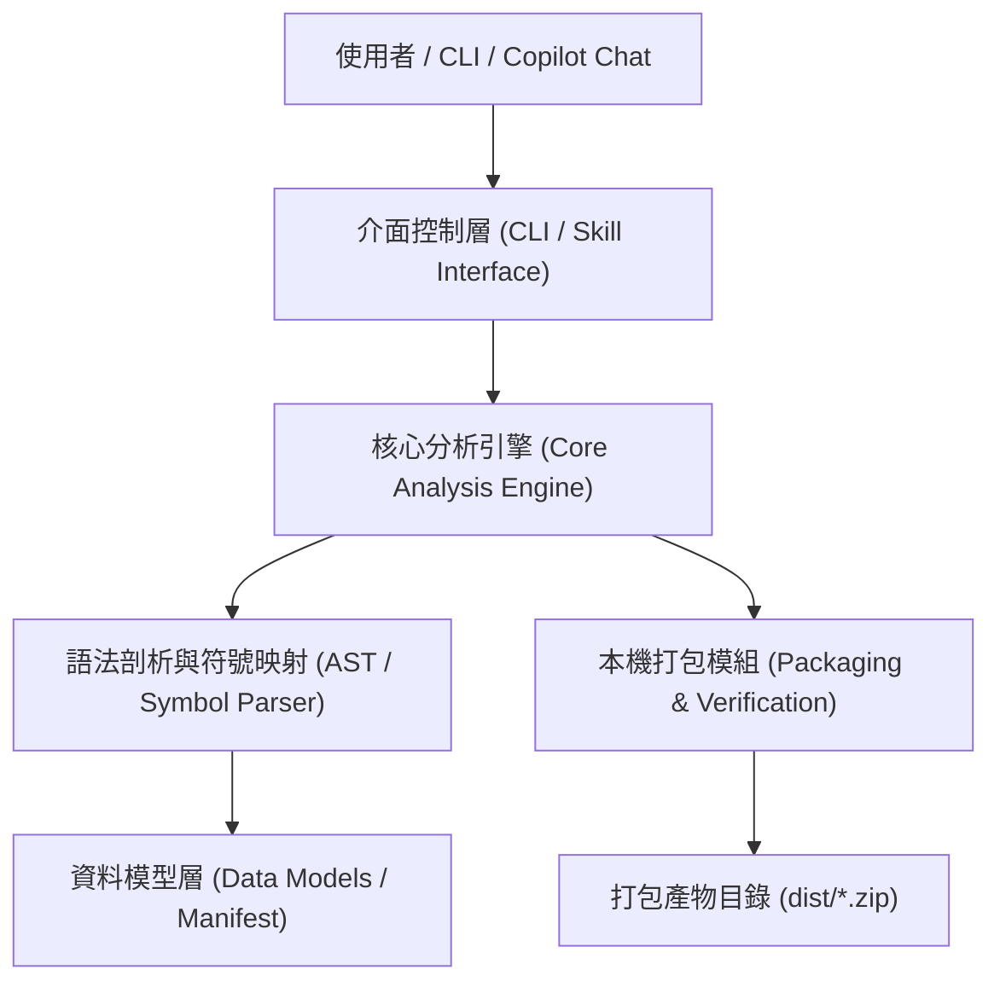
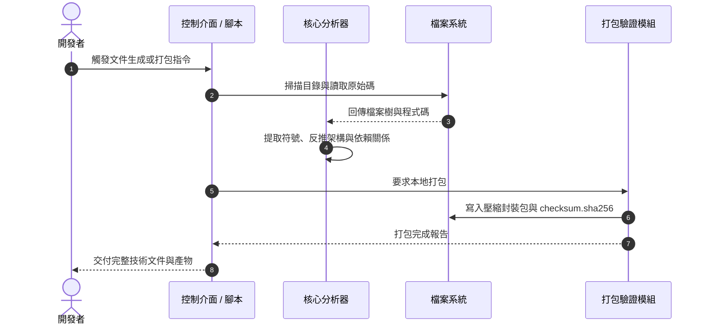

# {{PROJECT_NAME}} 技術文件

本文件包含系統的使用方法、本地打包與安裝、技術細節、系統架構以及關鍵程式碼解析。

---

## 1. 使用方法 (Usage Guide)

### 1.1 快速入門
說明如何在最短步驟內啟動或使用本專案：

```powershell
# 範例啟動指令
./run-app.ps1 -Mode "Default"
```

### 1.2 指令與介面參數 (CLI / API Parameters)
列出主要命令列選項或 API 介面定義：

| 參數名稱 | 型別 | 預設值 | 必要 | 說明 |
|---|---|---|:---:|---|
| `-Path` | `string` | `"."` | 否 | 指定目標分析專案目錄 |
| `-Output` | `string` | `"./docs"` | 否 | 產出文件儲存路徑 |
| `-Verbose` | `switch` | `false` | 否 | 顯示詳細執行日誌 |

### 1.3 典型使用場景 (Scenarios & Examples)

#### 場景 A：基礎情境
```powershell
# 輸入範例
./scripts/tool.ps1 -Target "src/"

# 預期輸出
# [INFO] Processed 12 files successfully.
```

---

## 2. 安裝方法與本地打包 (Installation & Local Packaging)

### 2.1 環境需求 (Prerequisites)
- 作業系統：Windows 10 / 11、Linux、macOS
- 執行環境：PowerShell 7+ / 5.1 或相應 Runtime (如 Node.js >= 18, Python >= 3.10)
- 必要工具：Git

### 2.2 本地打包流程 (Local Packaging Step-by-Step)
本專案支援完全離線的本機打包，產出可獨立散布的套件包。

#### 步驟 1：執行打包指令
```powershell
# 使用隨附之打包腳本
.\scripts\package-skill.ps1 -SkillName "{{SKILL_NAME}}" -OutputDir ".\dist"
```

#### 步驟 2：打包產物目錄結構
打包完成後於 `dist/` 目錄產出以下檔案結構：
```text
dist/
├── {{PROJECT_NAME}}-v1.0.0.zip       # 壓縮封裝包
├── manifest.json                     # 套件中繼資訊與檔案清單
└── checksum.sha256                   # SHA-256 校驗值
```

#### 步驟 3：產物完整性校驗 (Integrity Verification)
在傳輸或部署前，可透過雜湊校驗確保檔案未遭竄改：
```powershell
# 驗證 SHA256 雜湊
Get-FileHash -Path ".\dist\{{PROJECT_NAME}}-v1.0.0.zip" -Algorithm SHA256
```

### 2.3 本機安裝與部署 (Local Installation)

#### 個人全域安裝 (Global User Scope)
將打包產物解壓至個人 Copilot / 系統工具目錄：
```powershell
Expand-Archive -Path ".\dist\{{PROJECT_NAME}}-v1.0.0.zip" -DestinationPath "$HOME\.copilot\skills\{{PROJECT_NAME}}" -Force
```

#### 單一專案導入 (Target Repository Scope)
導入特定專案以供團隊共同版本控制：
```powershell
Expand-Archive -Path ".\dist\{{PROJECT_NAME}}-v1.0.0.zip" -DestinationPath ".\.github\skills\{{PROJECT_NAME}}" -Force
```

---

## 3. 技術細節 (Technical Details)

### 3.1 配置參數與常數規格
| 設定項目 | 內部常數 / 環境變數 | 資料型態 | 預設值 | 說明 |
|---|---|---|---|---|
| 最大深度 | `MAX_SEARCH_DEPTH` | `int` | `5` | 限制目錄遍歷遞迴上限 |
| 逾時時間 | `TIMEOUT_SECONDS` | `int` | `30` | 單次外部命令最大等待秒數 |

### 3.2 狀態機與生命週期 (State Machine)
```text
[Init] ---> [Scanning] ---> [Analyzing] ---> [Rendering] ---> [Complete]
                 |               |
                 +-----> [Error / Aborted]
```

### 3.3 錯誤處理與安全保護機制
1. **路徑安全檢查**：所有外部輸入之路徑皆經合法化過濾，防範目錄遍歷攻擊（Directory Traversal）。
2. **防禦性執行**：預設採用唯讀（Read-Only）或預檢模式（Dry-Run），未獲明確授權不進行破壞性寫入。
3. **例外攔截**：捕捉特定 I/O 例外並降級處理，輸出具體錯誤診斷資訊而非直接崩潰。

---

## 4. 系統架構 (System Architecture)

### 4.1 系統分層架構 (Layered Architecture)



### 4.2 核心流程循序圖 (Sequence Diagram)



### 4.3 模組責任矩陣

| 模組名稱 | 原始碼路徑 | 主要職責 | 外部依賴 |
|---|---|---|---|
| 控制介面 | `scripts/*.ps1` | 接收命令列引數、參數校驗與環境檢查 | PowerShell Core / Desktop |
| 分析引擎 | `engine/` | 靜態分析代碼、提取型別與依賴拓撲 | 內建正則或剖析器 |
| 打包模組 | `scripts/package-*.ps1` | 封裝本機產物、計算 SHA256、生成清單 | .NET `System.IO.Compression` |

---

## 5. 代碼對應解釋 (Code Map & Component Deep-Dive)

### 5.1 檔案結構映射
```text
.
├── scripts/
│   ├── run.ps1                 # 進入點控制腳本
│   └── package-skill.ps1       # 本機打包與校驗核心腳本
├── templates/
│   └── template.md             # 文件產出模板
└── SKILL.md                    # Skill 定義與行為規範
```

### 5.2 核心符號與函式走讀 (Symbol Breakdown)

#### `scripts/package-skill.ps1`
- **`New-SkillPackage`**
  - **位置**：`scripts/package-skill.ps1#L20-L65`
  - **職責**：過濾排除目錄（如 `.git`, `node_modules`），打包指定目錄為 zip。
  - **關鍵邏輯**：使用 `[System.IO.Compression.ZipFile]` 確保跨平台相容性。

- **`Get-PackageChecksum`**
  - **位置**：`scripts/package-skill.ps1#L70-L85`
  - **職責**：計算打包成品之 SHA-256 雜湊，產生 `checksum.sha256` 驗證檔。

### 5.3 關鍵代碼段落拆解

```powershell
# 範例：安全目錄過濾與打包
$excludeList = @('.git', 'node_modules', 'dist', 'bin', 'obj')
$filesToPack = Get-ChildItem -Path $sourcePath -Recurse | Where-Object {
    $item = $_
    -not ($excludeList | Where-Object { $item.FullName -like "*\$_*" })
}
```
**解說**：
1. 建立排除名單，防範將暫存檔、建置快取或 Git 歷史納入本地打包產物。
2. 逐一比對完整路徑，確保產出之打包檔維持最小化且乾淨。
