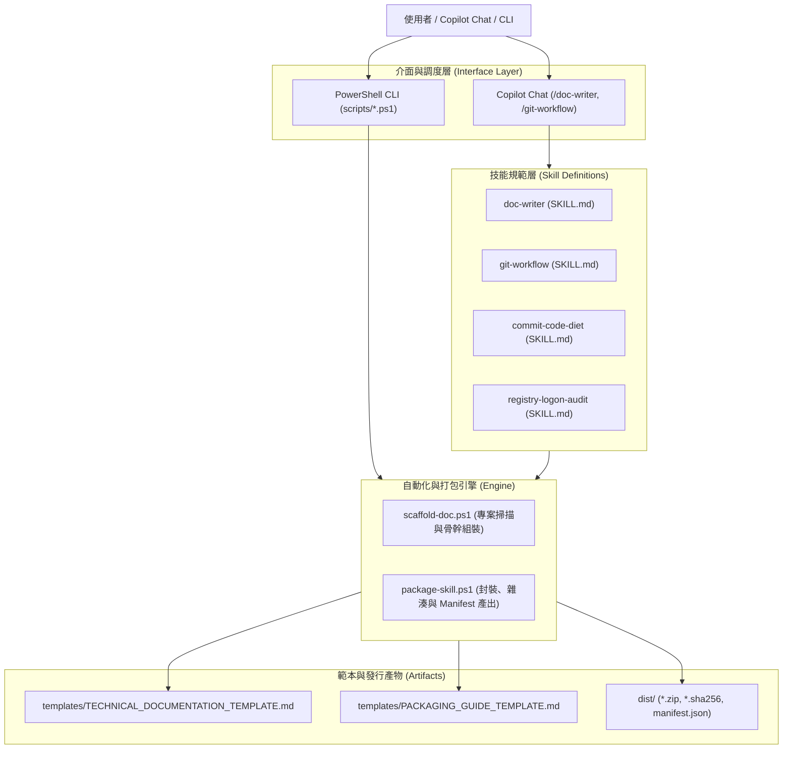
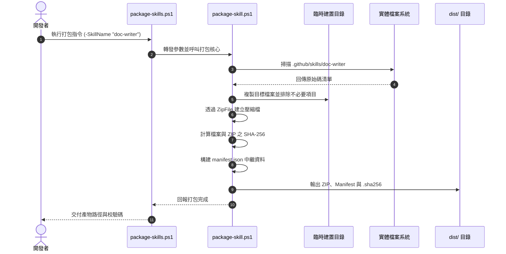

# Workflow Skills 技術架構與開發文件

本文件為本專案之核心技術文檔，嚴格落實五大規範維度：**使用方法**、**安裝方法與本地打包**、**技術細節**、**系統架構**與**代碼對應解釋**。

---

## 1. 使用方法 (Usage Guide)

### 1.1 快速入門
在 VS Code Copilot Chat（建議 Agent 模式）中，直接輸入 Skill 名稱或自然語言指令以啟動對應工作流：

```text
/doc-writer 為目前專案撰寫完整的技術文件，儲存至 docs/TECHNICAL_DOCS.md，需包含使用方法、安裝方法(含本地打包)、技術細節、架構與代碼對應解釋。
```

```text
/git-workflow 檢查目前 repo 工作區狀態，分開摘要 staged 與 unstaged 變更，先不要修改。
```

```text
/commit-code-diet HEAD 檢查冗餘條件、dead code 與 unused symbols，僅回報審查結果。
```

### 1.2 指令參數規格 (CLI / Tool Parameters)

#### 打包工具：`scripts/package-skills.ps1`
| 參數名稱 | 型別 | 預設值 | 必要 | 說明 |
|---|---|---|:---:|---|
| `-SkillName` | `string` | `"all"` | 否 | 指定打包目標（`"all"`、`"doc-writer"`、`"git-workflow"` 等） |
| `-OutputDir` | `string` | `"dist"` | 否 | 產物輸出資料夾 |
| `-Version` | `string` | `"1.0.0"` | 否 | 發行套件版本號 |

#### 初稿腳本：`.github/skills/doc-writer/scripts/scaffold-doc.ps1`
| 參數名稱 | 型別 | 預設值 | 必要 | 說明 |
|---|---|---|:---:|---|
| `-TargetPath` | `string` | `"."` | 否 | 欲分析並建立文件的目標目錄 |
| `-OutputFile` | `string` | `"docs\TECHNICAL_DOCS.md"` | 否 | 生成之 Markdown 儲存位置 |

### 1.3 典型使用場景與預期輸出

#### 場景 1：離線本地打包 Skill 套件
```powershell
powershell -ExecutionPolicy Bypass -File .\scripts\package-skills.ps1 -SkillName "doc-writer" -OutputDir "dist"
```
**預期輸出**：
```text
[*] Packaging Skill: doc-writer ...
    [+] Package: C:\Users\brian\Desktop\code\GitWorkflowSkill\dist\doc-writer-v1.0.0.zip
    [+] SHA256:  CB5A7640A0686E880E4016871D51B18B70386FA7F8C82996CE6DD35D3F85A274
    [+] Manifest: C:\Users\brian\Desktop\code\GitWorkflowSkill\dist\doc-writer-manifest.json

[v] Local packaging completed successfully! Output: C:\Users\brian\Desktop\code\GitWorkflowSkill\dist
```

#### 場景 2：自動產生專案文件初稿
```powershell
powershell -ExecutionPolicy Bypass -File .\.github\skills\doc-writer\scripts\scaffold-doc.ps1 -TargetPath "." -OutputFile "dist\test-doc.md"
```
**預期輸出**：
```text
[*] Scanning project directory: C:\Users\brian\Desktop\code\GitWorkflowSkill ...
[v] Technical doc scaffold generated successfully: C:\Users\brian\Desktop\code\GitWorkflowSkill\dist\test-doc.md
```

---

## 2. 安裝方法與本地打包 (Installation & Local Packaging)

### 2.1 環境需求 (Prerequisites)
- **作業系統**：Windows 10 / 11（支援 64-bit PowerShell 5.1 或 PowerShell Core 7+）
- **相依套件**：Git for Windows 2.30+
- **執行工具**：VS Code 與 GitHub Copilot Chat 擴充套件

### 2.2 本地打包流程 (Local Packaging Step-by-Step)
本專案提供完全本機執行的離線打包機制，不需外部網路連線或註冊表推送。

#### 步驟 1：執行封裝腳本
```powershell
# 於專案根目錄執行全技能打包
powershell -ExecutionPolicy Bypass -File .\scripts\package-skills.ps1 -SkillName "all" -OutputDir "dist" -Version "1.0.0"
```

#### 步驟 2：產物規格與目錄結構
打包過程會自動排除 `.git`、快取與暫存檔，產物輸出於 `dist/`：
```text
dist/
├── commit-code-diet-manifest.json
├── commit-code-diet-v1.0.0.zip
├── commit-code-diet.sha256
├── doc-writer-manifest.json
├── doc-writer-v1.0.0.zip
├── doc-writer.sha256
├── git-workflow-manifest.json
├── git-workflow-v1.0.0.zip
├── git-workflow.sha256
├── registry-logon-audit-manifest.json
├── registry-logon-audit-v1.0.0.zip
└── registry-logon-audit.sha256
```

#### 步驟 3：產物完整性驗證 (SHA-256 Checksum)
```powershell
# 檢驗 ZIP 檔之 SHA-256 雜湊
Get-FileHash -Path ".\dist\doc-writer-v1.0.0.zip" -Algorithm SHA256
```
可將計算結果與 `dist\doc-writer.sha256` 進行比對，確認未遭中途竄改。

### 2.3 本機安裝與部署方式

#### 全域安裝（所有 workspace 共用）
```powershell
# 解壓已打包套件至個人 Copilot 目錄
Expand-Archive -LiteralPath ".\dist\doc-writer-v1.0.0.zip" -DestinationPath "$HOME\.copilot\skills\doc-writer" -Force
```

#### 專案導入（隨特定 Repo 版本控制）
```powershell
Expand-Archive -LiteralPath ".\dist\doc-writer-v1.0.0.zip" -DestinationPath ".\.github\skills\doc-writer" -Force
```

---

## 3. 技術細節 (Technical Details)

### 3.1 設定參數與規格常數
| 常數 / 變數名稱 | 型態 | 預設值 | 說明 |
|---|---|---|---|
| `OutputDir` | `string` | `"dist"` | 本地打包產物儲存目標路徑 |
| `Version` | `string` | `"1.0.0"` | 套件版本編號，注入 Manifest 中繼資料 |
| `ErrorActionPreference` | `string` | `"Stop"` | 確保遇到非預期例外時立即中斷並報錯 |
| `Set-StrictMode` | `string` | `Latest` | 強制嚴格語法模式，防範變數未宣告或屬性存取錯誤 |

### 3.2 狀態轉換流程 (Lifecycle & State Transition)
```text
[未封裝原始碼]
      │
      ▼ (執行 package-skills.ps1)
[臨時隔離沙盒目錄] ──(過濾排除 .git, dist, .tmp)──> [純淨檔案樹]
      │
      ▼ (壓縮封裝)
[產生 ZIP 封裝包] ──(計算雜湊)──> [計算 SHA-256]
      │                                 │
      ▼                                 ▼
[生成 manifest.json]             [寫入 .sha256 檔]
      │                                 │
      └──────────────┬──────────────────┘
                     ▼
          [交付至 dist/ 目錄]
```

### 3.3 錯誤處理與安全邊界 (Error Handling & Security Boundaries)
1. **路徑正規化與防禦**：
   - 透過 `[System.IO.Path]::GetFullPath` 鎖定實體目錄，防範相對路徑遍歷（Directory Traversal）。
2. **純 ASCII 腳本設計**：
   - Windows PowerShell 5.1 在多位元字元集（CP950 / Big5）環境下對 UTF-8 without BOM 解析容易引發符號截斷。本專案將腳本邏輯與文本範本解耦，腳本核心採用 ASCII，中文內容存於 UTF-8 範本檔，徹底杜絕編碼崩潰問題。
3. **唯讀與明確授權原則**：
   - 所有 Skill 預設進行狀態審查與報告，未獲使用者明確授權前，絕不自動執行 `git commit`、`git push`、`git reset` 或覆寫原始碼。

---

## 4. 系統架構 (System Architecture)

### 4.1 模組分層架構圖 (Layered Architecture)



### 4.2 核心流程時序圖 (Sequence Diagram)



### 4.3 模組責任矩陣

| 模組名稱 | 原始碼路徑 | 主要職責 | 關鍵依賴 |
|---|---|---|---|
| 打包進入點 | `scripts/package-skills.ps1` | 提供專案根層級 CLI 打包呼叫介面 | PowerShell 5.1+ |
| 打包工作核心 | `.github/skills/doc-writer/scripts/package-skill.ps1` | 執行檔案過濾、ZIP 壓縮、計算 SHA256、產出 manifest.json | `System.IO.Compression` |
| 文件骨架掃描 | `.github/skills/doc-writer/scripts/scaffold-doc.ps1` | 掃描專案檔案、辨識專案類型、套用標準範本 | `TECHNICAL_DOCUMENTATION_TEMPLATE.md` |
| 文件規範規格 | `.github/skills/doc-writer/SKILL.md` | 定義 Copilot Chat 產出五大章節之指令行為與約束 | GitHub Copilot Agent |
| 封裝範本資產 | `.github/skills/doc-writer/templates/*` | 提供各語言生態系打包範本與標準技術文件範本 | Markdown 標準 |

---

## 5. 代碼對應解釋 (Code Map & Component Deep-Dive)

### 5.1 專案目錄結構
```text
.
├── .github/
│   └── skills/
│       ├── commit-code-diet/
│       │   └── SKILL.md                          # 單一 Commit 程式碼審查技能
│       ├── doc-writer/
│       │   ├── SKILL.md                          # 技術文件生成技能核心規範
│       │   ├── scripts/
│       │   │   ├── package-skill.ps1             # 本地打包核心腳本
│       │   │   └── scaffold-doc.ps1              # 專案初稿骨幹生成腳本
│       │   └── templates/
│       │       ├── PACKAGING_GUIDE_TEMPLATE.md   # 本地打包指引範本
│       │       └── TECHNICAL_DOCUMENTATION_TEMPLATE.md # 五大章節技術文件範本
│       ├── git-workflow/
│       │   └── SKILL.md                          # Git 操作日常技能
│       └── registry-logon-audit/
│           ├── SKILL.md                          # 登錄檔啟動項稽核技能
│           └── scripts/
│               └── scan-registry-logon.ps1       # 註冊表掃描腳本
├── docs/
│   ├── INSTALLATION.md                           # 導入指南與本地打包使用說明
│   ├── TECHNICAL_DOCS.md                         # 系統完整技術設計文件 (本檔)
│   └── USAGE.md                                  # 完整使用手冊與指令情境
├── scripts/
│   └── package-skills.ps1                        # 專案根層級本地打包入口
└── README.md                                     # 專案概覽與快速上手
```

### 5.2 核心檔案與符號走讀對照表

#### 1. `scripts/package-skills.ps1`
- **定位**：根層級統一 CLI 封裝工具。
- **職責**：自動解析專案結構並呼叫 `package-skill.ps1`。

#### 2. `.github/skills/doc-writer/scripts/package-skill.ps1`
- **函式 `Package-SingleSkill`**：
  - **位置**：`package-skill.ps1#L65-L151`
  - **輸入**：`$SkillDir`（目錄資訊）、`$TargetDir`（目標輸出路徑）、`$PkgVersion`（版本號）。
  - **輸出**：封裝好的 `.zip`、`manifest.json` 與 `.sha256`。

#### 3. `.github/skills/doc-writer/scripts/scaffold-doc.ps1`
- **邏輯區塊**：
  - **位置**：`scaffold-doc.ps1#L58-L85`
  - **職責**：自動依據 `package.json`, `Cargo.toml`, `go.mod`, `pyproject.toml`, `*.csproj`, `*.psd1` 辨識專案語言與生態系，並讀取標準 Markdown 範本進行佔位符替換。

### 5.3 關鍵程式碼段落剖析

#### 核心片段：排除清單與 SHA-256 雜湊產生 (`package-skill.ps1`)
```powershell
# 1. 建立純淨檔案清單，排除版本控制目錄與暫存快取
$files = @(Get-ChildItem -LiteralPath $SkillDir.FullName -Recurse -File | Where-Object {
    $_.FullName -notmatch '\\\.git\\' -and
    $_.FullName -notmatch '\\dist\\' -and
    $_.Extension -ne '.tmp'
})

# 2. 逐一複製並記錄個別檔案的 SHA256 雜湊
$fileManifest = @()
foreach ($file in $files) {
    $relPath = $file.FullName.Substring($SkillDir.FullName.Length).TrimStart('\', '/')
    $targetFilePath = Join-Path $destSkillDir $relPath
    # 建立目標子目錄並複製
    Copy-Item -LiteralPath $file.FullName -Destination $targetFilePath -Force

    $hash = (Get-FileHash -LiteralPath $file.FullName -Algorithm SHA256).Hash
    $fileManifest += [PSCustomObject]@{
        Path   = $relPath -replace '\\', '/'
        Size   = $file.Length
        SHA256 = $hash
    }
}
```

**深層邏輯解析**：
1. **陣列強制型別轉換 `@(...)`**：在 PowerShell 5.1 嚴格模式 (`Set-StrictMode -Version Latest`) 下，若目錄僅有一個檔案，`Get-ChildItem` 會回傳單一物件而非陣列，存取 `.Count` 會丟出例外。透過 `@(...)` 包裹確保永遠取得陣列結構。
2. **純淨複製機制**：不在原始目錄下直接壓縮，避免壓縮過程將生成的 `.zip` 自身或同時生成的暫存檔打包進去。
3. **Manifest 雙層校驗**：除了為整個 ZIP 壓縮包計算雜湊外，在 `manifest.json` 內部同時記錄各別檔案的雜湊值與檔案大小，便於進行細粒度的組件稽核。
